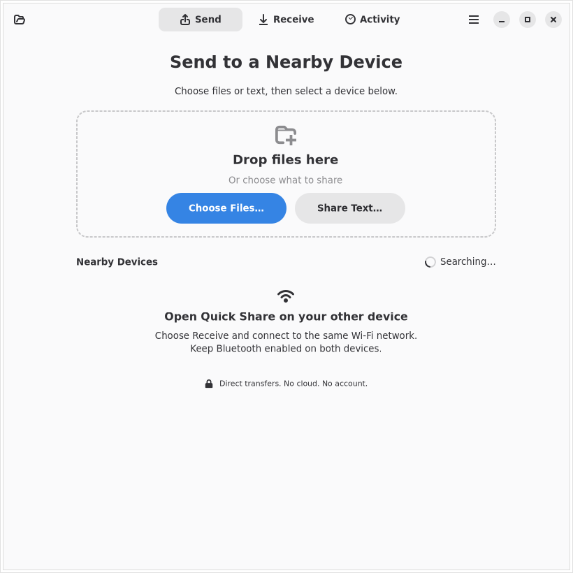

# GNOME Quickshare

[](https://github.com/oddship/gnome-quickshare/actions/workflows/ci.yml)
[](https://github.com/oddship/gnome-quickshare/actions/workflows/flatpak.yml)

**Share a little closer.** A fresh, native GTK 4/libadwaita application for sending
files, links, and text to nearby devices with Quick Share.

Development preview. The interface and protocol integration are implemented;
physical Android/Windows interoperability and GNOME Shell integration are not
release-validated. Packet is a partial implementation of Quick Share, and this
app uses a locally hardened copy of its transport engine with the same interoperability limits. See
[protocol research](docs/PROTOCOL.md) and [validation status](docs/STATUS.md).

<picture>
  <source media="(prefers-color-scheme: dark)" srcset="docs/screenshots/send-dark.png">
  
</picture>

## Run

Run directly from this repository with `nix run github:oddship/gnome-quickshare`.
From a local checkout:

```sh
nix run path:.
```

A local Flatpak development bundle can also be built and installed; see the
[Flatpak instructions](scripts/flatpak/README.md). It targets GNOME 50 and has
passed an installed sandbox GUI/local-transfer check.

GitHub Actions checks formatting, Clippy, protocol tests, Nix packages,
localization, and the native file/Wi-Fi interface flows on pushes and pull
requests. A separate workflow builds the Flatpak and runs its offline SDK tests.
Successful runs provide an unsigned x86_64 development bundle in their artifacts;
these are development builds, not signed releases. Both workflows can also be run
manually from the [Actions page](https://github.com/oddship/gnome-quickshare/actions).

For development:

```sh
nix develop path:.
cargo run
cargo run -- /absolute/path/to/a-file.pdf
cargo test --no-default-features
cargo test -p rqs_lib --no-default-features --lib
```

The flake pins Nixpkgs; Cargo.lock pins all Rust dependencies, with the rquickshare source vendored from an exact revision and its local patches
documented in `vendor/rqs_lib/PROVENANCE.md`. `path:.` works in a new directory without Git metadata.
After adding files to a real Git checkout, ordinary `nix run .` also works.

Create a deterministic source archive with `python3 scripts/package-source.py
/tmp/gnome-quickshare-0.1.0-source.tar.gz`. It uses explicit project paths and
excludes credentials, agent state, caches and compiled catalogs.

## A native home for nearby sharing

- Adaptive Send, Receive, and Activity views; follows GNOME light/dark and accent settings.
- Portal-based file picking, drag-and-drop, multiple files, removable selections,
  and open-with/command-line integration.
- Nearby device discovery and direct encrypted LAN sharing of files, text, links
  and Wi-Fi credentials, including manually entered hidden-network details.
- Matching-code approval, decline, cancel, queued outgoing shares, progress,
  completion notifications, and reviewed text copying.
- Hidden by default, ten-minute visibility, and an explicit approval for every share.
- Configurable device name, receive folder, and TCP port. Settings are atomic.
- Optional background operation and start at login. Sandboxed builds request the
  desktop background portal; native installs use XDG autostart.
- Local transfer history with no filenames, text, authentication codes, or credentials;
  clear it in Preferences.
- Optional Nautilus context-menu integration, status notifier tray, and GNOME top-bar indicator.
- Desktop entry, application icon, AppStream metadata, Nix package and NixOS module.

## Connect

Keep Bluetooth enabled and connect both devices to the same Wi-Fi/LAN with mDNS.
On Android, open Quick Share and choose Receive before sending from this app.
To receive on the computer, turn on visibility in the Receive tab, share from
Android, compare the code, and accept. Received files go to
`~/Downloads/Quickshare` by default.

If discovery fails, check guest-network isolation, VPN routes, UDP 5353, and the
TCP port shown in Preferences. Choose a static port before creating firewall
rules. The optional NixOS firewall rule uses TCP 53317; set that same port in the
app. No firewall changes occur just by running the app.

Wi-Fi Direct, Google accounts/contacts-only sharing, relay transfers, resume,
directories are unavailable. The refreshed 0.1.0 development packages support
empty files and manually entered Wi-Fi credentials (WPA/WPA2 Personal, Open, WEP
and hidden networks). See
[the protocol boundaries](docs/PROTOCOL.md#boundaries-of-the-implementation).

## NixOS

Add this flake as an input and import `gnome-quickshare.nixosModules.default`:

```nix
programs.gnome-quickshare = {
  enable = true;
  openFirewall = true; # optional; set static TCP port 53317 in Preferences
};
```

The optional extension is built with `nix build path:.#gnome-extension`.
Its UUID is `gnome-quickshare@oddship.github.io`; installation does not enable it
automatically. The Files integration needs `nautilus-python` (on NixOS,
add `pkgs.nautilus-python` to `environment.systemPackages`). Restart Files after installing the extension.

## Desktop API

GApplication exports its standard interface at bus name
`io.github.oddship.GnomeQuickshare`, object
`/io/github/oddship/GnomeQuickshare` on the session bus. `org.gtk.Actions` exposes
`visible` (boolean, activate or change state), `device-name` (read-only string
state), `listen-port` (read-only unsigned integer state), and actions for preferences, help, file selection, and quit.
`org.freedesktop.Application.Open` accepts file URIs and activates the window.
The optional indicator uses this API, and the Nautilus extension uses the desktop
entry's standard file opening support.

## Verification

`cargo test --no-default-features` runs model and real encrypted TCP loopback
checks without touching Bluetooth hardware. The default Bluetooth build skips
that integration test. To exercise the actual GTK consent dialog with a separate
protocol peer:

```sh
nix develop path:.
cargo build
cargo build --no-default-features --features test-tools --bin quickshare-probe
QUICKSHARE_SMOKE_PROBE="$PWD/target/debug/quickshare-probe" scripts/ui-smoke.sh "$PWD/target/debug/gnome-quickshare" /tmp/quickshare-ui
```

The harness isolates XDG configuration/state, runs an Xvfb display and private
session bus, switches visibility, sends a real file, clicks Accept, and compares
the received bytes. Screenshots and logs go to the requested output directory.
No phone, real Bluetooth access, or GNOME session is needed for this check.

An opt-in [live GNOME Wayland check](scripts/desktop/README.md) also verifies
process-scoped accessibility consent, local transfer bytes and notification
dispatch using the actual desktop services.

## Localization

The interface and desktop metadata support gettext catalogs, named placeholders
and language-specific plurals. The current interface falls back to English;
reviewed language catalogs are still needed. See [translation instructions](po/README.md)
for catalog creation and the temporary accented-layout test.

## Credits and license

New application source: GPL-3.0-or-later. The protocol engine is
[nozwock/rquickshare](https://github.com/nozwock/rquickshare), derived from
[Martichou/rquickshare](https://github.com/Martichou/rquickshare), GPL-3.0.
[Packet](https://github.com/nozwock/packet) and
[NearDrop](https://github.com/grishka/NearDrop) supplied protocol research and
interoperability references. [NixOS Update Manager](https://github.com/oddship/nixos-update-manager)
supplied the native GNOME and reproducible packaging reference. The application
is independently written; it does not vendor Packet's interface. The vendored
protobuf schemas retain their Google Apache-2.0 and Chromium BSD notices; the
corresponding license texts are included in both package formats.
