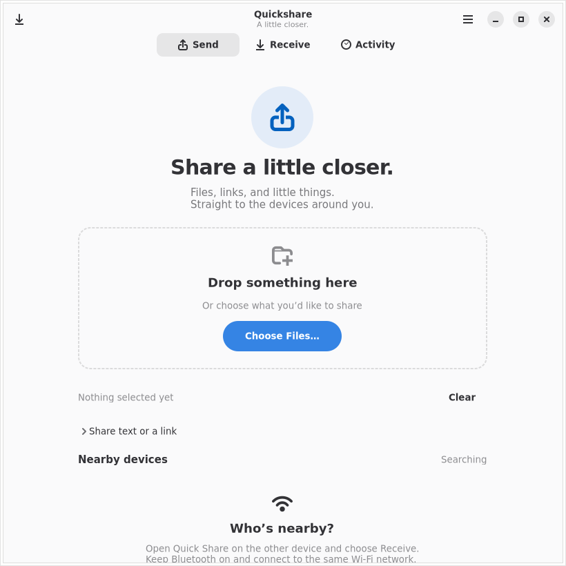
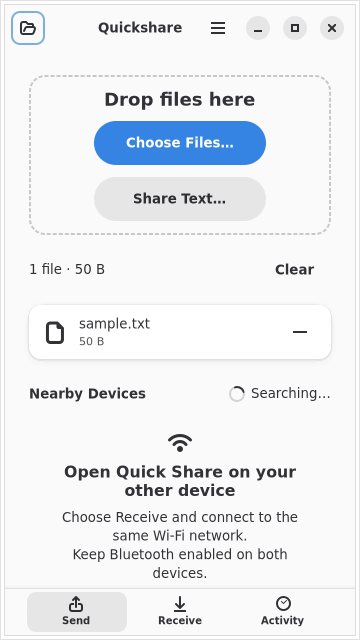
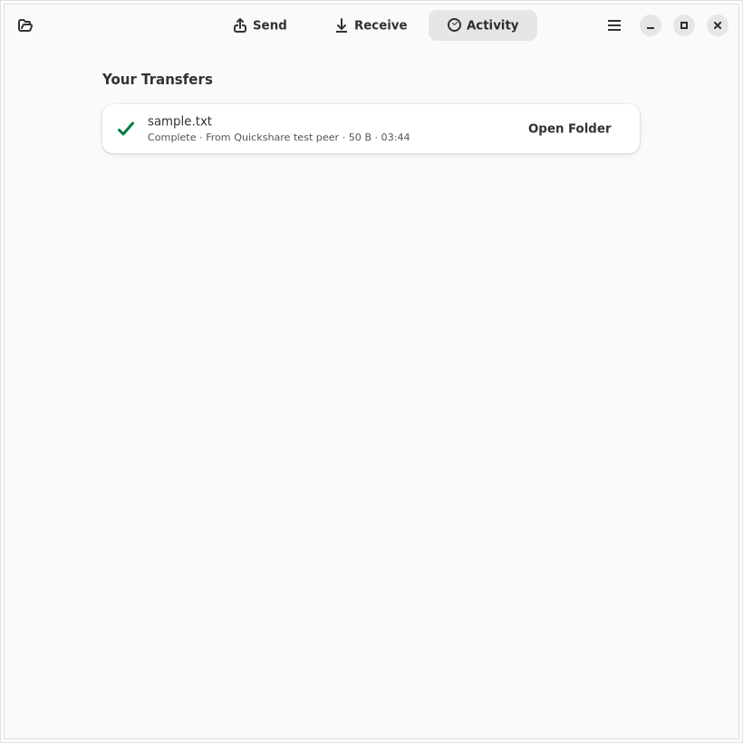
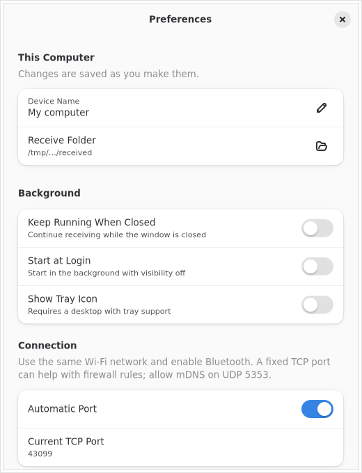

# Screenshot review and fixes

A Claude Opus 5.5 thread reviewed fresh native GTK captures, then re-checked the
implemented fixes twice. The final verdict was: “all four re-check items are
resolved. No blocking visual issues remain in this pass.”

- [Initial Claude review](ui-review/claude-review.md)
- [Second-pass review](ui-review/claude-recheck.md)
- [Final visual verdict](ui-review/claude-final.md)

## Captured flow

1. Send, with no selection, one selected file, and the text composer open.
   Compact task content now leaves Nearby Devices visible without scrolling at
   820x820. At 360x640, a breakpoint removes nonessential introductory content.
2. Receive, with timed visibility active. The countdown is part of the row;
   device-name editing and folder opening have explicit icons. Full paths remain
   in tooltips while display paths retain the destination basename.
3. A real local protocol peer requests a share. The driver captures the consent
   dialog, clicks Accept, compares received bytes, and captures the Activity row.
   Completion shows the filename, sender, size, time, success icon and Open Folder.
4. Preferences. The driver applies a new name, changes the background switch,
   closes and reopens the window, and verifies both settings in saved JSON.
   Invalid name input shows an error and leaves the saved name intact.
5. Responsive and theme checks. All tabs are captured at 390px and Send/Receive
   at 360x640; dark and Adwaita high-contrast captures exercise the same flow.

## Evidence

Before and after are actual window captures, not mockups:

The transfer regression initially exposed stale events in its cancellation
assertion. It now matches the new inbound transfer and the expected outbound
Cancelled event, rather than accepting any previous Disconnected event. The
corrected encrypted loopback check passed three consecutive runs.

## Limits

This review does not establish physical Android/Windows interoperability,
screen-reader compliance, or complete keyboard accessibility. Contrast was
sampled on light-theme completed-transfer subtitle strokes (3.15:1 before,
7.90:1 after); antialiased edge pixels were excluded. This is not a full WCAG
audit. Open Folder is intentional: the transport does not expose collision-resolved
destination filenames, so a direct Open action could open the wrong existing file.
Persistent history continues to exclude filenames and shared contents.

## Subsequent empty-file check

The native zero-byte smoke flow passes file selection, matching-code consent,
receipt and byte comparison after the peer exits, and completed Activity.
Nearby Devices remains visible with that file selected at 360×640.

A subsequent Xvfb/Cairo capture shows three tiny horizontal marks above the
Activity heading/card, including its empty state. They persist with a one-second
capture delay. Hiding the collapsed connection banner and clipping the header
individually did not remove them; those speculative changes were reverted.
The origin remains unconfirmed. This observation supplements the earlier Claude
verdict and needs comparison with a live Wayland capture before classifying it
as an application or capture-renderer defect.

## Wi-Fi sharing review

The current source adds manual Wi-Fi sharing. Claude reviewed its actual GTK
captures and requested a dedicated received-network dialog, explicit Wi-Fi consent,
less clutter in Activity and a compact preview. Those fixes are implemented.
The source smoke check also verifies Enter-to-prepare, masked credentials,
matching-code receipt, password-only clipboard copying, and settings/history
excluding the synthetic password. The new clipboard assertion reads only the
private Xvfb display's clipboard, using the development shell's GTK introspection
runtime. The refreshed 41-test Nix and Flatpak packages include these changes.

- [Initial Wi-Fi review](ui-review/claude-wifi.md)
- [Wi-Fi recheck](ui-review/claude-wifi-final.md)
- [Final Wi-Fi verdict](ui-review/claude-wifi-polished.md)
- [Masked draft](ui-review/wifi/wifi-filled.png)
- [360×640 Send preview](ui-review/wifi/wifi-small.png)
- [Wi-Fi-specific consent](ui-review/wifi/consent.png)
- [Received network review](ui-review/wifi/wifi-received.png)
- [Completed Wi-Fi transfer](ui-review/wifi/activity.png)

Claude's final Wi-Fi verdict confirms the remaining polish: a plain masked
password row with reveal/hide, a one-line preview title, and a clean Activity
capture. The password-only clipboard check and Enter action are separately
verified by the smoke driver. Source Clippy and the native build pass.

The Activity ticks were absent from a native GTK render-node texture. A full
Xvfb surface repaint also removes them; the capture harness now requests that
repaint by resizing away and back before Activity captures. Temporary application
widget/snapshot diagnostics and speculative banner/header/switcher changes were
removed. This resolves the stale pixels in the harness; it does not establish
real Wayland/GPU visual correctness or change GTK's renderer implementation.

## Wi-Fi theme verification

Dark, high-contrast light and high-contrast dark GTK runs pass the full Wi-Fi
form, consent, credential review, reveal/hide and password-only clipboard checks.
Claude's [theme review](ui-review/claude-wifi-themes.md) identified a faint custom
drop-zone border in high contrast. The app now follows AdwStyleManager's
high-contrast property (including its notify signal) and uses a 0.6 foreground
alpha for that border instead of 0.25. This avoids GTK 4.16-only media queries
and preserves the GTK 4.14 minimum. The ordinary theme rule remains unchanged.
The [theme recheck](ui-review/claude-wifi-themes-final.md) confirms the fix in both
high-contrast variants, with no clipping or remaining visible theme issue.
These screenshots do not establish WCAG compliance or real GPU rendering.

- [Dark review](ui-review/wifi-themes/dark-wifi-received.png)
- [High-contrast Send](ui-review/wifi-themes/high-contrast-wifi-small.png)
- [Dark high-contrast Send](ui-review/wifi-themes/high-contrast-dark-wifi-small.png)
